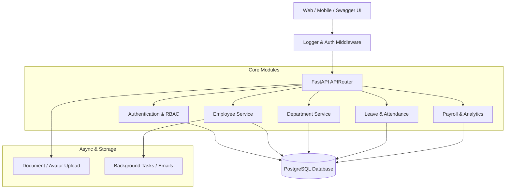
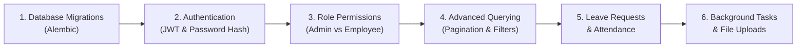

# FastAPI Project Expansion: Feature Roadmap & Architecture Guide

This document outlines a roadmap to expand your **Employee & Department Management System** into a production-grade **HRMS (Human Resource Management System)** backend.

---

## Architecture Overview



---

## 1. Authentication & Role-Based Access Control (RBAC)
> **Priority:** 🔴 High (Essential for any real-world app)  
> **Difficulty:** Medium

### 🎯 Purpose
Currently, anyone can create, edit, or delete employees and departments without logging in. Adding Authentication ensures that:
- Only authenticated users can access the system.
- **Role-Based Access Control (RBAC)** restricts actions (e.g., standard employees can only view their own profile, while HR/Admin can create/delete departments and modify salaries).

### 🗄️ Database Changes
Create a `User` model linked to the `Employee` model:
- `id`: Integer (PK)
- `email`: String (Unique, Indexed)
- `hashed_password`: String
- `role`: Enum (`ADMIN`, `HR`, `EMPLOYEE`)
- `is_active`: Boolean (Default: True)
- `employee_id`: Integer (FK -> `employees.id`, Nullable for superadmin)

### 🛣️ Routes Needed
| Method | Endpoint | Description | Access Level |
|---|---|---|---|
| `POST` | `/auth/register` | Register a new user | Public / Admin |
| `POST` | `/auth/login` | Login (returns JWT access token) | Public |
| `GET` | `/auth/me` | Fetch current logged-in user profile | Authenticated |
| `POST` | `/auth/refresh` | Refresh an expired access token | Authenticated |

### 📦 Packages Needed
```bash
pip install "passlib[bcrypt]" python-jose[cryptography] python-multipart
```

---

## 2. Pagination, Search, Sorting & Filtering
> **Priority:** 🔴 High  
> **Difficulty:** Easy–Medium

### 🎯 Purpose
If the company has 10,000 employees, `db.query(Employee).all()` will crash your server or cause extreme memory lag. Pagination and filtering ensure fast and scalable responses.

### 🛣️ Routes & Query Parameters
Instead of separate routes like `/getbydept`, add query parameters to your main listing routes:

#### `GET /employees`
- `page` (int, default: 1)
- `limit` (int, default: 10, max: 100)
- `search` (str, search by name or email substring)
- `department_id` (int, optional filter)
- `min_salary` & `max_salary` (int, salary range filter)
- `sort_by` (`name`, `salary`, `doj`) & `sort_order` (`asc`, `desc`)

#### Response Schema
```json
{
  "total": 120,
  "page": 1,
  "limit": 10,
  "total_pages": 12,
  "items": [ /* Employee list */ ]
}
```

---

## 3. Leave & Attendance Management
> **Priority:** 🟡 Medium  
> **Difficulty:** Medium

### 🎯 Purpose
Transforms your basic CRUD into a functional HR portal. Employees can request time off, and managers/HR can approve or reject requests.

### 🗄️ Database Changes
Create a `LeaveRequest` model:
- `id`: Integer (PK)
- `employee_id`: Integer (FK -> `employees.id`)
- `leave_type`: Enum (`SICK`, `CASUAL`, `PAID`, `UNPAID`)
- `start_date`: Date
- `end_date`: Date
- `reason`: String
- `status`: Enum (`PENDING`, `APPROVED`, `REJECTED`, default: `PENDING`)
- `reviewed_by`: Integer (FK -> `employees.id`, Nullable)
- `review_comment`: String (Nullable)

### 🛣️ Routes Needed
| Method | Endpoint | Description | Access Level |
|---|---|---|---|
| `POST` | `/leaves/apply` | Submit a leave request | Employee |
| `GET` | `/leaves/my-leaves` | View logged-in employee's leaves | Employee |
| `GET` | `/leaves/pending` | View all pending leave requests | HR / Manager |
| `PATCH` | `/leaves/{id}/status` | Approve or reject a leave request | HR / Manager |

---

## 4. File Upload (Profile Picture & Documents)
> **Priority:** 🟡 Medium  
> **Difficulty:** Easy

### 🎯 Purpose
Allows uploading employee profile photos (avatars) and documents (resumes, ID proof) either stored locally on the server or on AWS S3/MinIO.

### 🛣️ Routes Needed
| Method | Endpoint | Description | Format |
|---|---|---|---|
| `POST` | `/employees/{id}/avatar` | Upload profile image | `multipart/form-data` |
| `GET` | `/employees/{id}/avatar` | View/download profile image | Image file stream |
| `POST` | `/employees/{id}/documents` | Upload resume/contract (PDF) | `multipart/form-data` |

### 📦 Packages Needed
```bash
pip install python-multipart aiofiles pillow
```

---

## 5. Background Tasks & Email Notifications
> **Priority:** 🟡 Medium  
> **Difficulty:** Medium

### 🎯 Purpose
When an employee is created or a leave request is submitted, sending an email synchronously will freeze the API response for 1–3 seconds. FastAPI's built-in `BackgroundTasks` lets you send emails asynchronously after sending the HTTP response.

### 💡 Example Use Cases
1. **Welcome Email:** Send login credentials and welcome notes when an employee record is created.
2. **Leave Status Email:** Notify the employee immediately when their leave is approved or rejected.

### 🛠️ Implementation
Use FastAPI's native `BackgroundTasks`:
```python
from fastapi import BackgroundTasks

@employeeroutes.post("/create")
def create_employee(body: EmployeeBase, bg_tasks: BackgroundTasks, db: Session = Depends(get_db)):
    emp = controller.create_employee(body, db)
    bg_tasks.add_task(send_welcome_email, emp.name, emp.id)
    return emp
```

---

## 6. Payroll & Department Analytics
> **Priority:** 🟢 Nice to Have (Great for Resume)  
> **Difficulty:** Medium

### 🎯 Purpose
Provide aggregation and reporting endpoints that managers and accounting teams rely on.

### 🛣️ Routes Needed
| Method | Endpoint | Description |
|---|---|---|
| `GET` | `/departments/{id}/analytics` | Department metrics (Total payroll, average salary, employee count) |
| `GET` | `/analytics/salary-distribution` | Distribution of salaries across departments |
| `GET` | `/employees/{id}/payslip` | Generate monthly payslip breakdown (Basic, HRA, Tax deduction) |

### 💡 Technical Skills Practiced
- SQLAlchemy aggregate functions: `func.sum()`, `func.avg()`, `func.count()`, `GROUP BY`.
- Optional PDF generation using `reportlab`.

---

## 7. Professional Infrastructure & Tooling

To bring the codebase to standard production quality:

### 1. Database Migrations (Alembic)
- **Why:** `Base.metadata.create_all()` cannot alter existing tables (e.g. adding new columns or changing types).
- **Tool:** `alembic init alembic`
- **Benefit:** Keep track of database schema versions in Git.

### 2. Request Logging & Execution Time Middleware
- Measure response latency with a custom middleware:
```python
@app.middleware("http")
async def add_process_time_header(request: Request, call_next):
    start_time = time.time()
    response = await call_next(request)
    process_time = time.time() - start_time
    response.headers["X-Process-Time"] = f"{process_time:.4f}s"
    return response
```

### 3. Centralized Exception Handling
- Custom exceptions (e.g. `EntityNotFoundError`, `InsufficientPrivilegeError`) mapped to standardized JSON errors across all routes.

---

## Recommended Step-by-Step Implementation Plan


